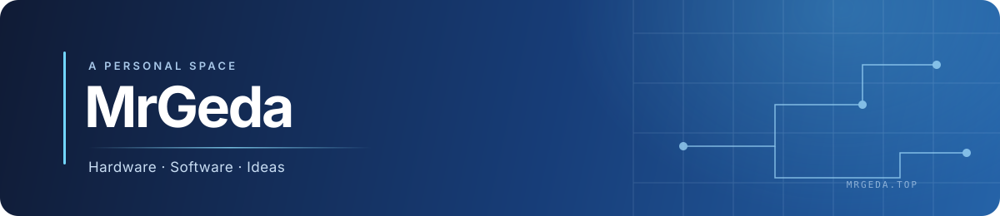

  

  

    <strong>你好，我是 MrGeda。</strong> 
    Hi, I'm MrGeda.
  

  

    
    
    
  

## Toolbox

  

  其他的嘛……主要由 AI 负责，我来当产品经理:) 
  For most of the rest, AI does the heavy lifting. I just here to serve as a product manager. :)

## 找到我 · Find Me

- 个人网站 / Website: [mrgeda.top](https://www.mrgeda.top/)
- GitHub: [@mrgeda-me](https://github.com/mrgeda-me)

## 贡献贪吃蛇 · Contribution Snake

  <picture>
    <source
      media="(prefers-color-scheme: dark)"
      srcset="https://raw.githubusercontent.com/mrgeda-me/mrgeda-me/output/github-snake-dark.svg"
    />
    <source
      media="(prefers-color-scheme: light)"
      srcset="https://raw.githubusercontent.com/mrgeda-me/mrgeda-me/output/github-snake.svg"
    />
    
  </picture>

  保持好奇，持续创造。 · Stay curious, keep building. 
  <a href="https://www.mrgeda.top/">mrgeda.top</a>

